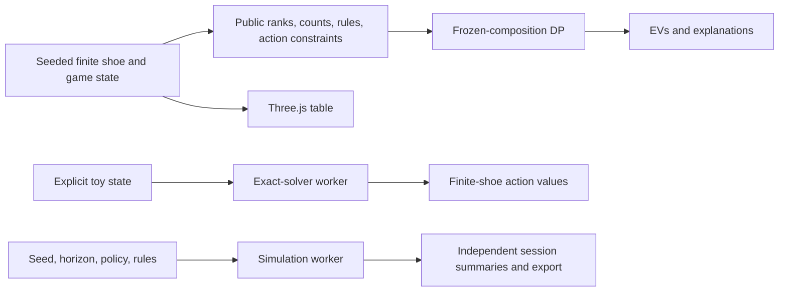

# Architecture and staged research plan

## Chosen boundary

React + TypeScript + Vite provide a portable static client with no server requirement. Three.js renders the table independently of the probability model. Pure TypeScript allows the same engine and state machine to run in tests, UI, and Web Workers. A future native/WASM engine can replace the solver implementation while preserving the explicit state and result contracts. No hosting service or backend is required for the foundation.

Four GPT-6.1 Sol delegates handled primary-source research, mathematical engine implementation, game state transitions, and 3D visualization. The research delegate subsequently performed an independent mathematical review. The principal integrated UI, experiments, contracts, tests, and documentation. Disjoint file ownership avoided concurrent modifications.

## Current data flow

The ordered shoe is never a solver argument. ENHC avoids hidden-card belief inference for this first milestone. The local game state is inspectable by a user with browser developer tools; this is a research application, not an adversarial multiplayer casino.

## Mathematical state

For one active unsplit hand: `(total, usableAce, cardCount, dealerUpcard, rankCounts, rules, actionMask)`. The natural flag and split context cannot be inferred solely from a total. Finite DP keys retain rankCounts. The fast surrogate omits count evolution and uses fixed probabilities. Hit/stand continuation is undiscounted expected net profit; optional double and split are initial decisions only. A dealer's blackjack event remains distinct from an ordinary dealer 21.

Finite-shoe split optimization needs all pending/completed hands, stakes, remaining composition, dealing protocol and eligibility, not just twice one hand's finite-shoe EV. Shared dealer outcomes matter for variance and utility even where linearity permits summing expectations. The current replacement split calculation is transparent about this boundary.

The engine ignores future bankroll constraints when evaluating the two initial split hands. Legal immediate actions are filtered by actual cash. An accurate constrained optimizer must carry cash and pending stakes through every decision, including allocation of cash between split hands.

## Validation boundaries

1. Utility correctness: multiple aces, natural detection, deterministic PRNG and rank counts.
2. Dealer distributions: normalization, natural mass, S17/H17 distinctions and terminal distributions.
3. Independent small-shoe oracle: brute-force ordered draws with per-observation player choice compared against memoized DP.
4. Independent sampled payout checks under the same replacement model, including double and split contexts.
5. State machine: illegal-action rejection, immutability, count conservation, payout accounting, seed replay, cut card, split aces and dealer-natural liability.
6. Experiment summaries: reproducible independent session seeds, consistent denominators and trace accounting.
7. Browser integration: actual WebGL canvas, dealing, solver worker, simulation worker, narrow viewport, and absence of page errors.

The implemented model is validated within these scopes. Upstream executables have not been run for numerical parity; primary-source review is not a claim of cross-engine equivalence.

## Next milestones

### 1. Full-shoe exact single-hand engine

Profile larger states, reuse dealer combinatorial caches and exploit equivalent hand compositions. Return model ID, policy class, state counts, runtime, numerical tolerance and version alongside every action. Add pinned upstream fixture comparisons under exactly matched rules. Support cancellation and resource budgets through the worker protocol. Full-shoe exact requests may need WASM or native batch execution.

### 2. Hidden-card belief state

Add an American-peek rule family with a public observation adapter, latent-card posterior and correctly conditioned player draw probabilities. Optimize over observations, not sampled hidden worlds. Add negative-peek and no-peek benchmark cases and metamorphic hidden-order invariance tests before making this playable.

### 3. Joint finite-shoe splitting

Represent pending hands, completed totals/stakes, depletion from all hands, cash and mandatory draw order. Distinguish fixed post-split policy evaluation from fully adaptive optimization. Validate no-resplit two-hand enumeration first, then resplits and resource-aware bounds. Do not substitute two independent finite-shoe hands.

### 4. Betting and bankroll MDP

Expose terminal wealth utility, horizon, table limits, minimum bet, credit constraints and ability to sit out. Optimize expected money, log utility and target/ruin objectives separately. Compute complete correlated round-return distributions, especially split hands. A mean EV alone is insufficient for exact Kelly sizing. Compare policies using paired independently seeded sessions and sequentially valid uncertainty methods where appropriate.

### 5. Research tooling

Replay/import versioned experiment records; persistent local sessions; scenario editing with deck-composition controls; side-by-side solver deltas; full expandable decision trees; confidence bands and ruin intervals; batch exports; parameter sweeps; benchmarks and continuous integration. Cosmetic table gestures can evolve independently of solver correctness.

## Intentional exclusions in v0.1

No American hole card, surrender, insurance, resplits, full finite-shoe split solver, optimal betting solver, infinite-horizon ruin guarantee, or promised positive profitability. No secure multiplayer state or external publication. These are explicit staged extensions, not disabled controls masquerading as implemented features.
