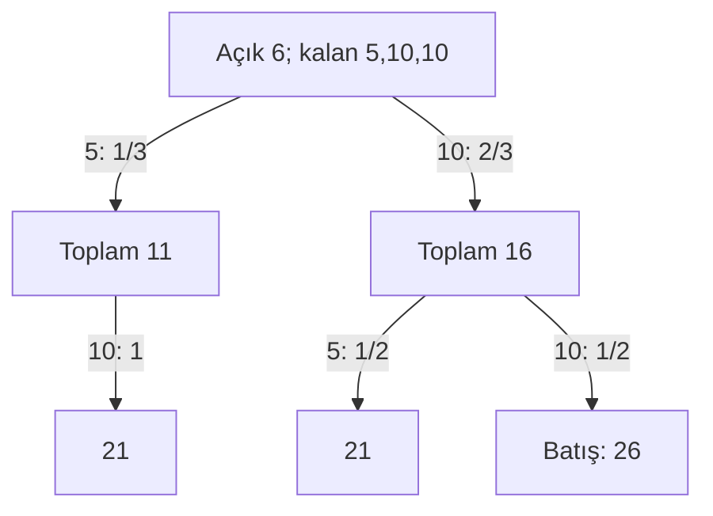
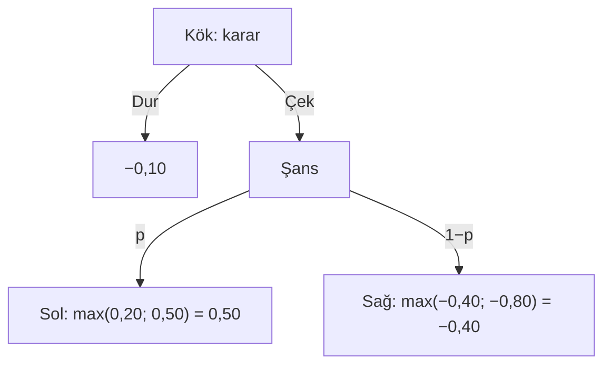

# Blackjack MDP Lab: oyundan olasılığa, karardan riske

**Türkçe öğrenme kitabı · Başlangıçtan ileri modele · 12 Kasım 2026**

Bu metin üniversite düzeyinde olasılık, beklenen değer ve koşullu olasılık bildiğinizi; blackjack oynamayı ise hiç bilmediğinizi varsayar. Amacımız bir strateji tablosunu ezberlemek değil, tablonun neden ortaya çıktığını kurabilmektir. Bir kartın anlamından başlayacak; aynı kartların nasıl olasılık ağacına, ağacın dinamik programa, programın da bir karar ve risk modeline dönüştüğünü göreceğiz. Matematik burada oyunu açıklayan bir dil olacak.

Kitap **Blackjack MDP Lab'ın mevcut ENHC kurallarını** anlatır. Başka masalarda farklı kurallar aynı el için farklı sonuç verebilir. Özellikle “krupiyede gizli kart var mı?”, “blackjack kaç ödüyor?” ve “krupiyenin blackjack'i ek bahisleri de alıyor mu?” soruları modelin parçasıdır. Gizli kartlı oyunları ileride, mevcut uygulamadan ayrı bir genişleme olarak inceleyeceğiz.

Üç tür sayıyı ayıracağız: **elle türetilmiş örnek** doğrudan gösterilen hesaptır; **oyuncak model** öğretim için seçilmiş yapay olasılıklardır; **motor çıktısı** mevcut koddan yeniden üretilebilen sonuçtur. Oyuncak modeldeki yüzde elli gibi sayılar gerçek blackjack sıklıkları değildir. Motor çıktılarının girdileri [tutorial-examples.json](tutorial-examples.json), üreticisi [tutorial-examples.mjs](../scripts/tutorial-examples.mjs) dosyasında bulunur. Değerler ilk bahsin birimi başına **net kâr** cinsindendir.

Her bölümü şu sırayla okuyun: sezgi, tanım ve denklem, çözülmüş örnek, uygulamada karşılığı, kendini sınama. Soruyu çözmeden açıklamayı okumamaya çalışın. Markdown görüntüleyiciniz açılır cevapları desteklemiyorsa cevap metinlerini normal devam paragrafları olarak okuyabilirsiniz. Matematik özel bir LaTeX motoru gerektirmez.

## İçindekiler

1. [Masada ilk beş dakika: bir tur nasıl oynanır?](#bolum-01)
2. [As, sert ve yumuşak el; natural ile 21 ayrımı](#bolum-02)
3. [Bahis, net nakit, double, split ve kural sözleşmesi](#bolum-03)
4. [Sonlu deste: koşullama, eksilme ve hipergeometrik dağılım](#bolum-04)
5. [Beklenen değer: kazanma oranından karar ölçütüne](#bolum-05)
6. [Krupiye dağılımını özyinelemeyle hesaplamak](#bolum-06)
7. [Bellman denklemi: sayısal bir ağacı geriye çözmek](#bolum-07)
8. [Durum, eylem maskesi ve sonlu–donmuş model ayrımı](#bolum-08)
9. [Hi-Lo ve gerçek sayı: bilgiyi sıkıştırmak](#bolum-09)
10. [Bahis seçimi, avantajlı durumlar ve split kovaryansı](#bolum-10)
11. [Monte Carlo: standart hata, oturumlar ve güven aralığı](#bolum-11)
12. [Sermaye, fayda ve Kelly: neyi eniyiliyoruz?](#bolum-12)
13. [İflas olasılığı: sonlu ufuk ve sınır koşulları](#bolum-13)
14. [Gizli kart, negatif peek ve inanç durumu](#bolum-14)
15. [Hesaplama karmaşıklığı, çalışma planı, sözlük ve kaynaklar](#bolum-15)

<a id="bolum-01"></a>
## 1. Masada ilk beş dakika: bir tur nasıl oynanır?

### Sezgi: rakibiniz diğer oyuncular değil, krupiyedir

Blackjack'te **el**, size dağıtılan kartların grubudur. **Tur**, ilk bahsin konulmasından bütün ellerin ödenmesine kadar geçen süreçtir. **Krupiye**, oyuncunun karşısındaki kurallı eldir; kendi tercihine göre strateji seçmez. Amaç, 21'i aşmadan krupiyeden yüksek toplam yapmaktır. 21'i aşmaya **batmak**, İngilizce *bust*, denir. Krupiye de batabilir. Siz önce batarsanız, krupiyenin sonradan batması kaybınızı kurtarmaz. Bu işlem sırası, oyunun matematiğinde çok önemlidir.

2–9 yazan kartlar üzerlerindeki sayıyı taşır. 10, vale, kız ve papaz on değerlidir; metinde bunların tümünü **T** ile göstereceğiz. Ası **A** ile yazacağız; as uygun olduğunda 11, gerektiğinde 1 sayılır. Takımlar, yani kupa, karo, maça ve sinek, bu uygulamanın olasılık modelinde kararları değiştirmez. Dolayısıyla `[T♠] [6♥]` çizimi bir süstür; motora verilen değerler `[10,6]` olur.

Şimdi başlangıç sermayeniz 100 birim ve bahsiniz 10 birim olsun. Kartlar şu sırayla dağıtılır: sizin ilk kartınız, krupiyenin açık kartı, sizin ikinci kartınız. Örnek görüntü:

| Taraf | Kartlar | Bilinen toplam |
| --- | --- | --- |
| Siz | `[T♠] [6♥]` | Sert 16 |
| Krupiye | `[T♦]` | Bir açık onluk |

Lab'ın **European no hole card**, kısaca **ENHC**, düzeninde bu aşamada krupiyenin gizli ikinci kartı yoktur. Fiziksel olarak ayrılmış bir kartı tahmin etmiyorsunuz; krupiye ikinci kartını siz bitirdikten sonra alacaktır. Bu nedenle oyuncunun çektiği kartlar krupiyeye kalacak bileşimi değiştirir.

**Kart iste**, yani *hit*, elinize bir kart ekler. **Dur**, yani *stand*, elinizi tamamlar. Örneğin 16 üzerine `[4♣]` gelirse toplamınız 20 olur ve durabilirsiniz. Sonra krupiye ikinci kart olarak `[7♥]` çekerse toplamı 17 olur; varsayılan kuralla durur. Siz 20 ile 17'yi yenerek 10 birim net kazanırsınız. Başlangıçtaki 100 birim, bahis konulunca 90'a iner; ödeme sırasında 20 geri gelir; tur sonu sermaye 110 olur. Geri gelen 20'nin yarısı kendi bahsinizdir.

Başka bir dalda 16 üzerine `[T♣]` çekerseniz 26 ile batarsınız. Başka canlı oyuncu eliniz yoksa Lab krupiyeye gereksiz kart çektirmez. Sonuç −10'dur; sonraki destede kalan kartlar, krupiyenin yine de oynatıldığı alternatif bir simülasyondan farklı olabilir. Bir tur için aynı ödeme veren iki prosedür, sonraki turlar için aynı süreç olmak zorunda değildir.

### Uygulamada karşılığı

[game.ts](../src/game.ts) içindeki `deal`, `act`, `advance`, `finishDealer` ve `settle` bu sırayı uygular. [game.test.ts](../src/game.test.ts) içindeki “deals player, visible dealer, player…” ve “settles a bust without unnecessarily drawing…” testleri dağıtım ve durdurma sözleşmesini denetler. Canlı masada önce yalnızca kart akışını takip edin; henüz öneri sayısını ezberlemeye çalışmayın.

### Kendini sına 1

100 birimle başlayıp 10 bahis koydunuz. Eliniz 19, krupiye 19. Tur sonu para ve net kâr nedir?

<details><summary>Çözüm: beraberlikte ne geri gelir?</summary>

Bu sonuç **push**, yani beraberliktir. Bahis konulunca 90 kalan nakde kendi 10 biriminiz geri gelir. Tur sonu 100, net kâr 0'dır. “10 aldım, 10 kazandım” demek, yatırılan parayı ikinci kez kazanç saymaktır. Bütün EV hesaplarımız bu yanlışı önlemek için net değişimi kullanacak.

</details>

<a id="bolum-02"></a>
## 2. As, sert ve yumuşak el; natural ile 21 ayrımı

### Sezgi: as esnekliği, ek bir kaçış kapısıdır

**Yumuşak el**, toplam hesabında en az bir asın hâlâ 11 sayıldığı eldir. **Sert el**, hiçbir asın 11 sayılmadığı eldir. Yumuşaklık “elde as var” demek değildir. `[A] [6]` yumuşak 17 iken `[A] [6] [T]` sert 17'dir. Yeni onluk geldiğinde as 11'den 1'e düşer; el batmaz. Bu dönüşümü bilmeden toplamı 17 olan iki elin neden farklı öneriler aldığını anlayamazsınız.

Matematiksel hesap çok kısadır. Bütün asları önce 1 sayarak toplamı **L** olarak tanımlayın. Elde as varsa ve L + 10 ≤ 21 ise bir ası yükseltin. Son toplam L + 10, yumuşaklık doğru olur. Aksi durumda toplam L, yumuşaklık yanlış olur. İki ası aynı anda 11 yapmak en az 22 verdiğinden, 21'i aşmayan bir elde en fazla bir yükseltilmiş as bulunabilir.

| Kartlar | Önce tüm aslar 1: L | Son toplam | Neden? |
| --- | --- | --- | --- |
| `[A] [6]` | 7 | Yumuşak 17 | 7 + 10 ≤ 21 |
| `[A] [6] [T]` | 17 | Sert 17 | 17 + 10 > 21 |
| `[A] [A]` | 2 | Yumuşak 12 | Bir as yükselir |
| `[A] [A] [T]` | 12 | Sert 12 | As var; yükseltme yok |
| `[A] [A] [A] [8]` | 11 | Yumuşak 21 | 11 + 10 = 21 |

**Natural blackjack**, özgün, bölünmemiş başlangıç elinin iki kartla 21 olmasıdır: bir as ve bir onluk. Üç kartla yapılan 21, örneğin `[7] [7] [7]`, natural değildir. İki kart olmasına rağmen split'ten türeyen `[A] [T]` de natural değildir. Aynı toplamın farklı ödeme ve krupiye natural'ine karşı farklı sonucu vardır. Bu nedenle durum yalnızca “21” sayısıyla temsil edilemez; kart sayısı ve elin kökeni de gerekir.

Varsayılan 3:2 ödemede özgün natural, krupiyede natural yoksa ilk bahsin 1,5 katı net kazandırır. İki taraf natural ise sonuç push'tur. Split 21 sıradan bir 21 olarak en fazla normal 1:1 kazanç alır; krupiye natural'i karşısında kaybeder. Krupiyenin üç veya daha çok kartla 21 yapması da iki kartlık natural olayıyla aynı değildir.

Bu farkı sayıyla görelim. Bir oyuncak durumda krupiyenin natural olasılığı 0,20, sıradan 21 olasılığı 0,10, daha düşük toplam veya batma olasılığı 0,70 olsun. Özgün natural'in EV'si `0,20 × 0 + 0,80 × 1,5 = 1,20` birimdir. Split 21'in EV'si `0,20 × (−1) + 0,10 × 0 + 0,70 × 1 = 0,50` birimdir. Bunlar öğretim için atanmış olasılıklardır; gerçek masa frekansı değildir.

### Uygulamada karşılığı

[engine.ts](../src/engine.ts) içindeki `handValue`, asları bu kuralla değerlendirir. `AnalysisContext.split` natural uygunluğunu ve split asının zorunlu durmasını taşır. [engine.test.ts](../src/engine.test.ts) “card utilities”, “does not pay a live split 21 as a natural” ve “stands after the one mandatory card on a split ace” örneklerini içerir. Öğrenme atölyesinin el/as çalışmasında önce toplamı, sonra yumuşaklık durumunu, sonra natural uygunluğunu ayrı ayrı tahmin edin.

### Kendini sına 2

`[A] [A] [9]` kaçtır? Sonra `[T]` gelirse kaç olur? İki elde de natural var mıdır?

<details><summary>Çözüm: toplam ve natural farklı sorulardır</summary>

İlk elin düşük toplamı 11'dir; bir as yükselince yumuşak 21 olur. İkinci elde düşük toplam 21'dir; yükseltme yapılamaz, sert 21 olur. İkisi de ikiden fazla kart içerdiği için natural değildir. 21'e ulaşmak ile natural bonusuna hak kazanmak ayrı koşullardır.

</details>

<a id="bolum-03"></a>
## 3. Bahis, net nakit, double, split ve kural sözleşmesi

### Sezgi: hamleler kartları olduğu kadar maruz kalınan parayı da değiştirir

Başlangıç bahsini **b**, tur başı sermayeyi **B**, tur sonu sermayeyi **B′** diye tanımlayalım. Boyutsuz net getiri **X = (B′ − B) / b** olsun. Böylece normal galibiyet X = +1, kayıp X = −1, push X = 0, ödenen 3:2 natural X = +1,5 olur. Parasal net sonuç bX'tir. Bütün sonraki denklemlerde paydayı hatırlayın: X başlangıç bahsine göredir; toplam yatırılan paraya göre değildir.

**Double**, başlangıçtaki iki kartlı ele bir b daha yatırıp tam bir kart çekerek zorunlu durmaktır. Normal kazanç +2b, kayıp −2b, push 0 olur. 100 sermaye ve b = 10 ile başlarsanız ilk bahisten sonra 90, double'dan sonra 80 nakit kalır. Kazanırsanız toplam 40 geri gelir ve 120 ile bitirirsiniz. Net +20, yani X = +2'dir. Masadan 40 almak, 40 net kazanmak değildir.

**Split**, eşit değerli iki başlangıç kartını iki ele ayırıp ikinci el için bir b daha yatırmaktır. `[8] [8]`, `[8] [?]` ve `[8] [?]` olur. Lab iki yeni ikinci kartı da ilk split eli oynanmadan önce açık olarak dağıtır; sonra tamamlanmamış elleri sırayla oynar. En fazla iki el vardır; yeniden split yoktur. Split aslarının her birine yalnızca bir kart verilir, ardından zorunlu durulur. Diğer split ellerinde DAS açıksa iki kartlı ele double yapılabilir.

Örnek olarak iki sekizi 10'ar birimle bölüp her iki eli de double yaptınız. Toplam yatırdığınız 40'tır. ENHC'de krupiye daha sonra `[A] [T]` natural açarsa bu uygulama **bütün bahisleri kaybettirir**. Başlangıç 100 ise son 60, net −40, X = −4 olur. Sadece ilk 10'un kaybolduğunu varsayan “original bet only” başka bir sözleşmedir; burada kullanılmaz. Oyuncak anlatımlarda bile bu ayrımı değiştirmek double ve split EV'sini değiştirir.

Varsayılan kuralları tek yerde toplayalım:

| Kural | Mevcut oyun | Matematiksel etkisi |
| --- | --- | --- |
| Deste ve dağıtım | Altı deste, ENHC | 312 kart; önceden ayrılmış gizli kart yok |
| Krupiye | S17: yumuşak 17'de durur | Sonuç dağılımını belirler |
| Natural ödeme | 3:2 | Net +1,5; 6:5 seçilirse +1,2 |
| Double | İlk iki kartta; varsayılan DAS açık | Bir ek bahis, tek kart, zorunlu durma |
| Split | Bir kez; en fazla iki el | İkinci bahis ve ortak krupiye |
| Surrender / insurance | Yok | Teslim olma ve sigorta eylemleri yok |
| Kesme eşiği | %75 tüketim, turlar arasında | El içinde yeniden karıştırma yok |

H17 seçeneği yalnızca **yumuşak** 17'de kart çektirir; sert 17'yi değiştirmez. 6:5'e geçişte, diğer olaylar sabitken, ödenen her natural'in net getirisi 0,30 b azalır. DAS'ın kapanması mümkün eylemleri azaltır. Bunlar kozmetik ayarlar değildir. Kural değiştirildiğinde Lab oturumu sıfırlar; eski ve yeni sonuçları aynı deneymiş gibi birleştirmeyin.

### Uygulamada karşılığı

[game.ts](../src/game.ts) `legalActions` ile bugünkü nakdi, `act` ile ek bahisleri, `settle` ile geri dönen tutarı yönetir. [game.test.ts](../src/game.test.ts) içinde “can double each split hand and loses all four stakes…” ve “gives split aces exactly one card…” bu kuralları somutlaştırır. Çözücünün gelecekteki nakit varsayımını Bölüm 8'de ayrıca inceleyeceğiz.

### Kendini sına 3

b = 10 ile iki ele split yaptınız. Double yok. Bir el kazanıyor, diğeri push oluyor. Toplam geri ödeme, net kâr ve X nedir?

<details><summary>Çözüm: el sonuçlarını net olarak toplayın</summary>

20 yatırdınız. Kazanan el 20, push el 10 döndürür; toplam geri ödeme 30'dur. Net 30 − 20 = 10; başlangıç bahsi 10 olduğundan X = +1. Toplam yatırılan 20'ye bölerseniz +0,5 bulursunuz, fakat bu başka bir getiri tanımıdır. EV tablosuyla karşılaştırırken aynı paydayı kullanmalısınız.

</details>

<a id="bolum-04"></a>
## 4. Sonlu deste: koşullama, eksilme ve hipergeometrik dağılım

### Sezgi: görünen kart geçmişi, gelecek olasılığını değiştirir

Bir torbadan geri koymadan top çekmekle blackjack kartı çekmek aynı olasılık yapısına sahiptir. **nᵣ**, henüz çekilmemiş r değerli kart sayısı; **N = Σᵣ nᵣ**, toplam kalan kart sayısı olsun. ENHC'de görünen oyuncu kartları ve açık krupiye kartı bu vektörden çıkarılmıştır. Sonraki kartın r olması `P(r) = nᵣ / N` olur. r gelince sonraki durum `n − eᵣ` olur; **eᵣ**, yalnızca r bileşeni 1 olan vektördür.

Örneğin taze tek destede 4 as ve 16 onluk vardır. İlk çekilişte onluk olasılığı 16/52 ≈ %30,7692'dir. Bir onluk çıktıktan sonra 15/51 ≈ %29,4118 olur. Bir as çıktıktan sonra ise 16/51 ≈ %31,3725 olur. “Bir kart gitti” tek başına yeterli bilgi değildir; **hangi** kartın gittiği gerekir. Öğrenme atölyesindeki deste eksiltme kontrolü bu pay ve payda değişimini görünür kılar.

Sıralı iki kart için çarpım kuralı koşullu olasılık içerir. Taze tek destede natural olasılığı iki ayrık sıranın toplamıdır:

```text
P(A sonra T) = (4/52) × (16/51)
P(T sonra A) = (16/52) × (4/51)
P(natural)  = 2 × (4/52) × (16/51)
            = 32/663 ≈ 0,0482654600 = %4,82654600.
```

İkinci paydanın 52 olması bağımsız, geri koymalı çekiliş modeli olurdu. Aynı hesabın sırasız biçimi `C(4,1) C(16,1) / C(52,2) = 64/1326` verir. **C(a,k)**, a elemandan k eleman seçme sayısıdır. Araya krupiyenin bilinmeyen açık kartının dağıtılması, oyuncunun iki pozisyonunun koşulsuz marjinalini değiştirmez; fakat açık kart görüldükten sonra artık o karta koşullamanız gerekir. “Taze elin olasılığı” ile “şu anda gördüklerime koşullu olasılık” farklı sorulardır.

Altı deste için aynı türetim `2 × (24/312) × (96/311) ≈ 0,0474894880` verir. Doğal blackjack olasılığı destelerin sayısından hafifçe etkilenir. Bu sayı **ödenen natural sıklığı** değildir; krupiye natural'iyle push olabilecek elleri de içerir. Payout hesabına geçerken iki tarafın ortak olayını da değerlendirmek gerekir.

Genel olarak N kartın K tanesi aradığınız türdense, geri koymadan çekilen m kartta tam k başarı olasılığı **hipergeometrik dağılım** ile bulunur:

```text
P(Y = k) = C(K,k) × C(N−K,m−k) / C(N,m).
```

Burada Y başarı sayısıdır; sıralama önemli değildir. On kartlık bir oyuncak torbada dört onluk varken iki çekilişte tam bir onluk için `C(4,1) C(6,1) / C(10,2) = 24/45 = 8/15` bulunur. İki onluk için `C(4,2)/C(10,2) = 6/45` olur. Bunlar sonlu örneklem hesabıdır; oyuncunun ne zaman duracağına bağlı bir el dağılımını doğrudan aynı formüle sıkıştırmayın. Durma politikası örneklem uzunluğunu rastgele yapar.

### Uygulamada karşılığı

[engine.ts](../src/engine.ts) `freshCounts` fonksiyonunda tek deste `[4,4,4,4,4,4,4,4,4,16]` olarak kurulur. `draws` sonlu modda bir kartı gerçekten eksiltir. [game.ts](../src/game.ts) `draw` fiziksel diziyle sayım vektörünü birlikte günceller. [game.test.ts](../src/game.test.ts) sayımın fiziksel kartlarla uyuştuğunu uzun tur dizilerinde denetler.

### Kendini sına 4

Taze tek desteden bir as ve iki onluk görüldü. Kalan deste N kaçtır? Sıradaki iki kartın ikisinin de onluk olması olasılığı nedir?

<details><summary>Çözüm: iki adımda da eksiltin</summary>

49 kart, bunların 14'ü onluktur. Olasılık `(14/49) × (13/48) = 13/168 ≈ 0,07738095` olur. İkinci adımda 14/49'u tekrar kullanmak eksilmeyi yok sayar. Önceki asın artık onluk sayısını azaltmadığını, yalnızca toplamı azalttığını da fark edin.

</details>

<a id="bolum-05"></a>
## 5. Beklenen değer: kazanma oranından karar ölçütüne

### Sezgi: kaç kez kazandığınız kadar, kazanınca ve kaybedince ne olduğu önemlidir

Bir **politika**, karşılaşacağınız her bilgi durumunda hangi eylemi seçeceğinizi belirleyen kuraldır. s mevcut durum, a seçilen eylem, X başlangıç bahsi başına net getiri olsun. **Q(s,a) = E[X | s,a, belirtilen devam politikası]** eylemin beklenen değeridir. EV, bir sonraki turun kesin sonucu değil; aynı koşul ve politika altında getirilerin olasılık ağırlıklı ortalamasıdır. Parasal EV, b × Q olur.

Önce yapay bir ödeme tablosu kuralım. A seçeneği %45 olasılıkla +1, %45 ile −1, %10 ile 0 versin. Kazanma oranı %45, EV `0,45 − 0,45 = 0` olur. B seçeneği %40 ile +1,5, %50 ile −1, %10 ile 0 versin. Kazanma oranı daha düşük, %40; fakat EV `0,40 × 1,5 − 0,50 = +0,10` olur. Bu iki seçenek öğretim için oluşturulmuştur; gerçek el dağılımı değildir. Ödeme büyüklüklerini yok sayan kazanma oranının neden yanlış sıralama verebildiğini gösterir.

Şimdi **gerçek motor girdisine** geçelim: altı taze desteden sizin `[T] [6]` ve krupiyenin `[T]` kartı çıkarılmıştır; S17, 3:2, DAS açık, ENHC vardır. [Sayısal kayıtta](tutorial-examples.json) `six-deck-16-v-10` senaryosu, donmuş frekans modelinde şunu verir:

| Eylem | EV: ilk bahis birimi başına net kâr |
| --- | ---: |
| Dur | −0,5772710719 |
| Kart iste | **−0,5706860204** |
| Double | −1,1413720407 |

En büyük sayı kart istemeye aittir; yine de negatiftir. “En iyi hamle”, seçenekler içinde en az kaybettiren hamle olabilir. Fark `−0,5706860204 − (−0,5772710719) = 0,0065850515` birimdir. b = 10 için beklenen fark yaklaşık 0,06585 parasal birimdir. Tek bir turda ise yüzdeler kadar ince bir sonuç görmezsiniz: örneğin −10 veya +10 görürsünüz. Küçük ortalama farkları büyük gerçekleşen dalgalanmaların içinden öğrenmek gerekir.

Bu elde sıradaki kartta batma olasılığı `189/309 ≈ %61,16505` olur: kalan 6, 7, 8, 9 ve onluklar batırır; sayıları `23 + 24 + 24 + 24 + 94 = 189`'dur. Buna rağmen kart istemek modelde daha iyidir; durmak sizi krupiyenin tamamlanan çok sayıda eline karşı kaybettirir. “Batma riski yüksek, durmalıyım” yalnızca tek dalı görür. Eylem EV'si bütün dalları, sonraki kararları ve krupiyenin sonucunu birleştirir.

**Pozitif avantaj** ise Q'nun sıfırdan büyük olmasıdır. Altı destelik `[5] [6]` karşı `[6]` motor senaryosunda dur −0,1503345682, kart iste +0,3405271679, double +0,6810543358'dir. b = 10 double seçimi için net EV yaklaşık +6,81054'tür; toplam risk altındaki para 20 olduğundan bu sayıyı yüzde 68'lik risksiz getiri diye okuyamazsınız. Bu ayrıca el dağıtıldıktan sonraki koşullu avantajdır: o eli görüp başlangıç bahsinizi geriye dönük yükseltemezsiniz.

### Uygulamada karşılığı

[engine.ts](../src/engine.ts) en yüksek yasal EV'yi seçer; devamda hit/stand eniyilenir. [engine.test.ts](../src/engine.test.ts) “selects … versus …” örneklerini, [validation.test.ts](../src/validation.test.ts) bağımsız örnekleme kontrollerini içerir. Öğrenme atölyesinde kazanma oranı ile ödeme kontrollerini oynatın; sonra motor destekli 16–10 örneğinde negatif iki sayının sıralamasını açıklayın.

### Kendini sına 5

Bir eylemin EV'si −0,20, diğerinin −0,35. İlkini seçmek avantajlı bir oyun bulduğunuz anlamına gelir mi? 50 birim bahis için aralarındaki beklenen fark nedir?

<details><summary>Çözüm: göreli iyileşme ve mutlak avantaj</summary>

İlk seçenek daha iyidir, fakat pozitif EV yoktur. Beklenen kayıplar sırasıyla 10 ve 17,5 birimdir; ilkini seçmek 7,5 birim beklenen kaybı önler. Bu, o turda 7,5 kesin kazanacağınız anlamına gelmez. Oyuna katılmama seçeneği yasalsa 0 getirisiyle ikisinden de iyi olabilir; dağıtılmış bir eldeyse geçmiş bahis zaten konmuştur ve yalnızca mevcut yasal eylemler karşılaştırılır.

</details>

<a id="bolum-06"></a>
## 6. Krupiye dağılımını özyinelemeyle hesaplamak

### Sezgi: krupiye bir strateji seçmez, bir kuralı yürütür

Oyuncu 16'da kart isteyebilir veya durabilir. Krupiye ise kendi tercihine göre davranmaz: toplam 17'nin altındaysa kart çeker; S17 kuralında yumuşak 17 dahil 17 ve üstünde durur. H17 seçeneğinde yalnızca yumuşak 17'de çekmeye devam eder. Dolayısıyla krupiyenin son toplamı, bütün olası kart sıralarının ve bu deterministik durma kuralının birleşimidir.

“On açıkken krupiye muhtemelen 20 yapar” sezgisi tek başına yeterli değildir. Durma EV'si için şu yedi ayrık sonucun olasılığına ihtiyacımız var:

`D = (P17, P18, P19, P20, P21, Pbust, PBJ)`.

Buradaki 21, **doğal olmayan** 21'dir; BJ ise ilk iki kartta oluşan doğal blackjack'tir. Birbirini dışlayan bu yedi olayın olasılıkları toplamı 1 olmalıdır. Doğalı ayrı tutmamızın nedeni, oyuncunun sıradan 21'inin doğal krupiye blackjack'ine yenilmesidir.

### Durumu nasıl saklarız?

Krupiyenin o anki durumunu `(t, u, k, c)` ile gösterelim: `t` aslar düzeltilmiş toplam; `u` kullanılabilir bir asın 11 sayılıp sayılmadığı; `k` zorunlu ikinci kartın henüz alınmadığını belirten bayrak; `c` kalan on rankın sayıları. As için yapılan düzeltme Bölüm 2'dekiyle aynıdır. Bir kart `r` geldiğinde yeni toplamı `T(t,u,r)` ve yeni yumuşaklık durumunu `U(t,u,r)` hesaplarız.

`D(t,u,k,c)` yedi boyutlu sonuç vektörü olsun. Durma koşuluna ulaşmışsak ilgili sonuç için birim vektörü döndürürüz. Örneğin sert 18'de `D = (0,1,0,0,0,0,0)`, batışta `D = (0,0,0,0,0,1,0)` olur. İkinci kartla doğal oluştuğunda BJ bileşeni 1 olur. Henüz çekmek gerekiyorsa:

**Sonlu destede:**

`D(t,u,k,c) = Σᵣ [cᵣ/N] D(T(t,u,r), U(t,u,r), yeni bayrak, c−eᵣ)`.

Burada `eᵣ`, yalnızca `r` bileşeni 1 olan vektördür. Doğal oluşturan ikinci kart dalı ayrıca BJ terminaline gider. Her dalda kart gerçekten çıkarılır. **Donmuş bileşim modelinde** aynı ağırlıklar kullanılır, fakat sonraki `c−eᵣ` yerine hep başlangıç `c`'si korunur. Formül benzer görünür; model farkı tam burada yaşar.

### Çözülmüş sonlu deste örneği: yalnızca üç kart

Krupiyenin açık kartı 6, kalan kartlar `[5, 10, 10]` olsun. Bu, gerçek bir tam deste değil; ağacı elle bitirebilmek için seçilmiş eksiksiz bir sonlu durumdur. Krupiyenin ikinci kartı:

- Olasılık 1/3 ile 5: toplam 11. Kalanların ikisi de 10, dolayısıyla üçüncü kartla 21 olur.
- Olasılık 2/3 ile 10: toplam 16. Kalan `[5,10]` içinden 1/2 ile 5 gelirse 21, 1/2 ile 10 gelirse 26 ve batış olur.



`P21 = 1/3 + (2/3)(1/2) = 2/3` ve `Pbust = (2/3)(1/2) = 1/3`. Diğer sonuçlar sıfırdır. Oyuncu sıradan 18 ile durursa krupiyenin batışında +1, 21'inde −1 alır:

`Q(dur) = (1/3)(+1) + (2/3)(−1) = −1/3`.

Böylece bir dağılımdan bir eylem değerine geçtik. Oyuncunun 18 olması tek başına yeterli bilgi değildi; krupiyenin tamamlanma dağılımı gerekiyordu.

### Doğal neden ayrı bir kutu?

Başka bir küçük durumda krupiye açık 10; kalanlar `[A,7,10,10]` olsun. Krupiye bir kart daha alıp hemen durur: doğal olasılığı 1/4, 17 olasılığı 1/4, 20 olasılığı 1/2. Sıradan 18'in durma değeri `1/4 − 1/2 − 1/4 = −1/2` olur. Oyuncu doğal A+10 ise yalnızca krupiye doğalında beraberlik, diğerlerinde 1,5 kazanır: `(3/4)×1,5 = 1,125`. Oyuncu split sonrası A+10 taşıyorsa bu doğal değildir ve değeri `(3/4)×1 − (1/4)×1 = 0,5` olur. Aynı toplam, farklı el kimliği, farklı ödeme.

Genel olarak sıradan oyuncu toplamı `t≤21` için:

`Q(dur | t,c) = Pbust − PBJ + Σⱼ₌₁₇²¹ Pⱼ sign(t−j)`.

Asıl oyuncu doğalı için `Q = blackjackPayout × (1−PBJ)`; oyuncu zaten batmışsa sonuç −1'dir. Krupiyenin doğal olmayan 21'i ile oyuncunun sıradan 21'i eşitliği sıfır katkı yapar.

### Uygulamada karşılığı

[engine.ts](../src/engine.ts) içindeki `dealerPlay`, `dealerAt` ve `stand` bu ayrımı uygular. Sonuç vektörü uygulamanın **Dealer outcome distribution** grafiğidir. Grafik, mevcut durumda **hemen durursanız** krupiyenin sonuç dağılımını gösterir; sonlu modelde kart çektikten sonra aynı dağılımın değişmeden kalacağını söylemez. [engine.test.ts](../src/engine.test.ts) dağılım normalizasyonunu, doğal kütlesini ve S17/H17 farkını sınar. Bağımsız kontrol, [validation.test.ts](../src/validation.test.ts) içindeki farklı el değerlendirmesi ve kart-sırası sayımıdır.

### Kendini sına 6

Krupiye için `Pbust=0,30`, `P17=0,20`, `P18=0,10`, `P19=0,15`, `P20=0,15`, `P21=0,05`, `PBJ=0,05` olsun. Sıradan oyuncu 18'inin durma EV'sini bulun. Bu sayılar yalnızca bir öğretim dağılımıdır.

<details><summary>Çözüm: kazanç, kayıp ve beraberlik kütlelerini ayır</summary>

Kazanç olasılığı 0,30+0,20=0,50; kayıp olasılığı 0,15+0,15+0,05+0,05=0,40; beraberlik 0,10. EV = 0,50−0,40=+0,10. Beraberlik olasılığını yanlışlıkla kazanca eklemeyin. Kazanma olasılığı %50 olsa da kaybetme olasılığı daha küçük olduğu için EV pozitiftir.

</details>

<a id="bolum-07"></a>
## 7. Bellman denklemi: sayısal bir ağacı geriye çözmek

### Sezgi: “bir kart çekmek” yalnızca bir sonuç değil, yeni bir karar yaratır

Hit seçince mutlaka bir kart alırsınız; batmazsanız çoğu zaman yeniden karar verirsiniz. Bu nedenle hit değeri, yalnızca yeni elin durma değerinin ortalaması değildir. Yeni elden sonra **en iyi devamı** hesaba katmalıyız. Double farklıdır: bahsi büyütür ama yalnızca bir kart aldırır; devam kararı bırakmaz.

Bir durum `s` için `A(s)` yasal eylemler kümesi, `Q(s,a)` eylem `a` seçilip sonrasında optimal devam edildiğinde beklenen net getiri olsun. Optimal durum değeri:

`V(s) = maxₐ∈A(s) Q(s,a)`.

Buradaki maksimum, oyuncunun gerçekten seçebildiği yerde alınır. Şans düğümünde maksimum alınmaz; olasılıkla ağırlıklı ortalama alınır. Bu iki işlemi doğru sıraya koymak dinamik programlamanın kalbidir.

### Tam sayısal öğretim ağacı

Şu küçük MDP'yi özellikle öğretim amacıyla tanımlayalım; sayılar blackjack dağılımı değildir. Kökte durmak −0,10 değerindedir. Çekmek, olasılık `p` ile sol duruma, `1−p` ile sağ duruma götürür. Sol durumda durmak +0,20, devam etmek +0,50; sağda durmak −0,40, devam etmek −0,80 değerindedir. Alt değerler artık bilinen son noktalardır.



Önce alt kararları çözeriz: `Vsol=0,50`, `Vsağ=−0,40`. Sonra şans düğümünü:

`Q(çek) = p×0,50 + (1−p)×(−0,40) = 0,90p−0,40`.

p=0,50 için `Q(çek)=0,05`. Kökte `max(−0,10;0,05)=0,05`, yani çekmek optimaldir. p=0,20 için `Q(çek)=−0,22`; bu kez durmak daha az kaybettirir. Karar eşiğini bulmak için eşitleriz: `0,90p−0,40=−0,10`, dolayısıyla `p=1/3`. Eşitlikte iki eylemin EV'si aynıdır; uygulamanın basit eşitlik tercihi ek bahis almayan eylemlere öncelik verir.

### Blackjack'e aktaralım

`h` oyuncu eli, `d` krupiye açık kartı, `c` kalan sayılar olsun. `h⊕r`, ele `r` eklemek demektir. Kart çektikten sonra kullanılan `V_HS`, artık double veya split olmayan **hit/stand devam değeridir**:

`Q_hit(h,d,c) = Σᵣ [cᵣ/N] V_HS(h⊕r,d,c−eᵣ)`.

Batış durumunda `V_HS=−1`. Sıradan 21'de yalnızca durma değeri kalır. Diğer durumlarda `V_HS=max(Q_stand,Q_hit)`. Başlangıçta iki kart ve yeterli para varsa double da adaydır:

`Q_double(h,d,c) = 2 Σᵣ [cᵣ/N] Q_stand(h⊕r,d,c−eᵣ)`.

Bu net getiri formülünde yatırılan bahsi ayrıca bir kez daha çıkarmıyoruz: sonuçlar zaten double kaybında −2 ve double kazancında +2. **Genelde `Q_double ≠ 2Q_hit`**; hit sonraki karar hakkını korur. Bazı özel ellerde eşitlik çıkabilir. Örneğin mevcut 11/6 senaryosunda motor iki değeri tam iki kat verir; bu tek örnek genel bir teorem değildir.

Doğal iki kartlı el zaten terminaldir. Split için iki elin ortak durumu gerekir; geri-koymalı modelde beklenen toplamı iki marjinal beklentinin toplamı olarak hesaplayabilsek de sonlu destede bunu aynı yöntemle tam sayamayız. Bu ayrımı Bölüm 10'da açacağız.

### Bilgisayar bütün ağacı tekrar tekrar mı geziyor?

Aynı alt duruma farklı yollarla varılabilir. **Memoization**, bir alt durumun sonucunu hesaplayıp anahtarla saklamaktır. Yeni bir dal aynı anahtara ulaşınca sonucu yeniden kullanırız. Bu ağacı, ortak alt problemleri olan yönlü bir grafa dönüştürür. Anahtarın yeterli bilgi taşıması şarttır: sonlu destede kalan kart sayıları atılırsa farklı gelecek dağılımları aynı durum sanılır ve artık başka bir model çözülür.

Bir elde çekişler küçük kart toplamını artırdığı için sonlu sayıda anlamlı devam vardır. Terminal koşullardan başlayıp geriye çözebiliriz; bu nedenle burada geleceği iskonto etmeye ihtiyaç yoktur. Genel MDP yazımındaki `Q=E[r+γV(s')]` için el içindeki bu görevde γ=1 kullanılır; ara ödülleri ve terminal net ödemeyi tutarlı tanımlamak gerekir. Aynı bahsi hem ara maliyet hem terminal kayıp olarak iki defa saymak yanlıştır.

### Uygulamada karşılığı ve alıştırma

**Öğrenme atölyesi → Bellman ağacı** deneyinde p kaydırıcısını değiştirin. `p=0,20`, `p=0,50` ve yaklaşık `1/3` değerlerinde kararı önce kendiniz bulun. Gerçek motorun `optimal`, `hit` ve `double` fonksiyonları aynı “maksimum/ortalama” sırasını kullanır. [learningMath.test.ts](../src/learningMath.test.ts) öğretim ağacının değerlerini, [engine.test.ts](../src/engine.test.ts) ise gerçek tek-el özyinelemesini farklı bir sayıcıyla sınar.

### Kendini sına 7

Sol durumda +0,50 eylemini seçebilmek, şans düğümünde de sol dalı seçebileceğiniz anlamına gelir mi? p=0,20 iken çekmenin değerini neden +0,50 alamayız?

<details><summary>Çözüm: kontrol ile rastlantıyı karıştırma</summary>

Sol duruma ulaştıktan sonra eylemi seçebilirsiniz; hangi duruma ulaşacağınızı seçemezsiniz. Çekme değeri `0,2×0,5+0,8×(−0,4)=−0,22` olmalıdır. +0,50 almak, sağ durumu sanki hiç yaşanmayacakmış gibi siler. Aynı hata gizli bir kartı bilmediğiniz halde ona göre farklı eylemler seçmekte de görülür.

</details>

<a id="bolum-08"></a>
## 8. Durum, eylem maskesi ve sonlu–donmuş model ayrımı

### Sezgi: geçmişi değil, geçmişin gelecek için gerekli özetini sakla

MDP, **Markov karar süreci** demektir. Bir durum, eldeki bilgi içinde geleceğin dağılımını ve yasal eylemleri belirlemeye yetecek bir özettir. Oyuncunun toplamını bilmek tek başına yeterli değildir. Sert 18 ile yumuşak 18 farklıdır; iki kartlı 11 ile üç kartlı 11 aynı double hakkına sahip değildir; doğal 21 ile split 21 aynı ödeme değildir. Sonlu destede aynı toplam ve açık kart, farklı kalan bileşimlerde farklı EV verebilir.

Tek elin zengin durumunu kavramsal olarak şöyle yazabiliriz:

`s = (h, d, c, kurallar, split_kimliği, yasal_eylemler)`.

Tüm turun tam durumu daha büyüktür: bekleyen split elleri, tamamlanmış ellerin toplam ve bahisleri, aktif el, kullanılabilir nakit, dağıtım sırası da gerekir. Tam bahis optimizasyonunda mevcut servet, zaman ufku, masa limitleri ve hedef fayda eklenir. Kodun bir türünü “MDP” olarak tanımlamak, bütün bu daha büyük problemleri çözmüş olduğumuz anlamına gelmez.

### Oyuncunun bilgisi ile simülatörün bilgisi

`game.ts` karıştırılmış kart sırasını saklar; bu, oyunu yürütmek için gereklidir. Analiz motoruna bu sıra verilmez. Motor `cards`, `up`, `counts`, `rules` ve uygunluk bağlamını alır. Böylece rastgele gelecek sırası aynı gözlenen sayımla değiştirilse bile analiz aynı kalır. [validation.test.ts](../src/validation.test.ts) bu değişmezliği özellikle test eder. Yerel dosya dışa aktarımı yeniden üretim için sıra içerebilir; o dosyayı okuyarak oynamak oyuncu-bilgisi modelinin dışına çıkmaktır.

`legalActions` nakit ve kural kısıtlarını uygular. Motor bağlamındaki `split`, `canDouble`, `canSplit` bayrakları mevcut elin kimliğini ve o anki izinleri taşır. Bayraklar yasak bir yeniden bölmeyi serbest bırakmaz. Fakat bu bayraklar, gelecekteki iki split eli arasında nakit ayıran tam bir servet MDP'si değildir.

### Aynı başlangıç durumu, iki farklı model

Oyuncu `[10,6]`, krupiye 10; **kalan** sayılar `[1,1,1,1,1,1,1,1,1,4]` olsun. Rank sırası A,2,…,9,10; toplam 13 karttır. Oyuncu kartları ve açık kart zaten bu sayılardan dışlanmıştır. Bu örnek altı destenin başlangıcı değildir.

| Eylem | Donmuş bileşim `analyze` | Sonlu deste `analyzeExact` |
| --- | ---: | ---: |
| Dur | −0,5757818468 | **−0,5592074592** |
| Kart iste | **−0,5752243196** | −0,5780238280 |
| Double | −1,1504486393 | −1,1560476560 |
| Seçilen eylem | Kart iste | Dur |

Başlangıç çekiş olasılıkları aynıdır. Fark, ilk çekişten **sonra** başlar. Örneğin tek as çekilirse sonlu modelde as sayısı sıfıra iner; donmuş modelde sonraki kartlarda hâlâ 1/13 as olasılığı vardır. Bu yalnızca oyuncunun devamını değil, ardından krupiyeye kalan dağılımı da etkiler. Donmuş modelin birçok basamakla yazılmış olması bu eksikliği gidermez.

Bu tabloyu **Gerçek motoru karşılaştır** deneyinde yeniden hesaplayabilirsiniz. Sonlu çözüm bu durumda 537, donmuş çözüm 30 farklı değerlendirilen DP durumu bildirir. Bunlar evrensel karmaşıklık sayıları değil, bu girdinin iş yüküdür. Dosyadaki sonuçları ezberlemek yerine aynı girdinin `tutorial-examples.json` içinde yer aldığını doğrulayın.

### “Tam” sözcüğünün burada anlamı

`analyzeExact` hit/stand/double için tüm pozitif olasılıklı sonlu geçişleri sayar ve hit/stand devamını optimize eder. Split eylemi üretmez. Sayılar kayan noktalıdır; sembolik rasyonel ispat çıktıları değildir. İşlem çağrı başına 100.000 durum bütçesiyle sınırlıdır; arayüz en fazla 18 kalan kart kabul eder. Durum bütçesi aşılırsa veya bir dal oyunu tamamlamak için olmayan bir kartı gerektirirse **açık hata** verir. Bu tür bir durumda sessizce yaklaşık sonuç döndürmez, kartı geri koymaz, keyfi olarak krupiyeyi durdurmaz.

Canlı masadaki `analyze`, gözlenen bileşimin frekanslarını alır; sonrasında geri-koymalı bir vekil modeli çözer. Kendi modeli içinde deterministik Bellman çözümü olması, gerçek sonlu deste için tamlık anlamına gelmez. Canlı öneriyi “mevcut hesaplama modeline göre en iyi yasal eylem” diye okumalıyız.

### Kendini sına 8

Motor yalnızca `(toplam, krupiye_açık_kartı)` anahtarıyla sonuçları saklarsa hangi bilgileri yanlışlıkla birleştirir?

<details><summary>Çözüm: yeterli istatistik kaybı</summary>

En azından sert/yumuşak el, kalan bileşim, doğal/split kimliği ve iki kart uygunluğu kaybolur. Örneğin A+7 ile 10+8 toplamı 18'dir ama bir sonraki karttaki batış davranışı aynı değildir. Toplam-bağımlı bir temel strateji ayrı bir yaklaşık/politika sınıfı olarak anlamlı olabilir; genel bileşim-bağımlı optimal çözüm diye sunulamaz.

</details>

<a id="bolum-09"></a>
## 9. Hi-Lo ve gerçek sayı: bilgiyi sıkıştırmak

### Sezgi: sayım kehanet değil, görülen kartların bilançosudur

Bir deste dengeli başladığında düşük ve yüksek kartlar belirli oranlardadır. Birçok düşük kart görünmüşse, kalan havuz yüksek kartlar bakımından zenginleşebilir. Sayım gelecek sırayı bilmez. Oyuncunun gördüklerinin, kalan dağılım hakkında taşıdığı bilgiyi ucuz bir özete dönüştürür.

Hi-Lo etiketi:

`w(r) = +1 (2≤r≤6); 0 (r=7,8,9); −1 (r=A veya r=10)`.

Görülen kartların toplam etiketi `RC = Σ görülen w(r)` olur. Taze standart destede etiket toplamı sıfırdır: 20 düşük kartın +20 katkısı, 4 as ve 16 onluğun −20 katkısıyla dengelenir. Bu yüzden pozitif RC, kalan kartların etiket toplamının negatif olduğunu söyler. “Yüksek kartlar zenginleşti” ifadesinin matematiksel başlangıcı budur.

Kalan deste eşdeğeri `D=N/52` ise kesirli **true count** `TC=RC/D` olarak tanımlanır. Aynı RC=+4, dört deste kalmışsa TC=+1; bir deste kalmışsa TC=+4 olur. Aynı dengesizlik daha küçük havuzda daha yoğun bilgi taşır. Kod kesirli değeri gösterir; farklı sistemlerin yuvarlama kurallarıyla üretilmiş strateji indekslerini bu değere düşünmeden uygulamamalıyız.

### Elle sayılan bir dizi

Görülen dizi `[2,5,K,A,7,6]` olsun; K motor içinde 10 değeridir. Etiketler `+1,+1,−1,−1,0,+1`; RC=+1. Tek desteyle başlanmışsa 46 kart kalır: `TC=1/(46/52)=52/46≈1,1304`. Bu sayı oyuncunun avantajının %1,1304 olduğu anlamına **gelmez**. TC bir bilgi özeti, EV ise kurallara ve politikaya bağlı beklenen ödemedir; farklı birimlerdir.

### Aynı sayı, farklı oyun

Taze tek desteden yalnızca bir as çıkarırsak RC=−1, N=51 olur. Yalnızca bir onluk çıkarırsak yine RC=−1, N=51 olur. Oysa sıradaki iki oyuncu kartının doğal olasılığı:

- As çıkmışken `2×3×16/(51×50)=96/2550≈%3,7647`;
- Onluk çıkmışken `2×4×15/(51×50)=120/2550≈%4,7059`.

Aynı true count, farklı doğal olasılığı! On boyutlu bileşimi tek sayıya indirgedik; bilgi kaybı kaçınılmazdır. Bu örneği **Kartlar ve koşullama** deneyinde iki kez sıfırlayarak yapabilirsiniz. Tam bileşim bilgisi olan motor için RC zorunlu bir girdi değildir; simülasyonda RC bahis politikası için kullanılan daha kaba bir özettir.

### Yüksek kartlar nasıl yardımcı olabilir?

Üç mekanizmayı ayrı düşünün. Birincisi, as ve onlukların birlikte bulunması oyuncu doğalının olasılığını etkiler; doğal galibiyetinin 3:2 ödemesi normal galibiyetten yüksektir. İkincisi, toplam 10 veya 11 gibi bazı double fırsatlarında yüksek kart değerli bir tamamlanma sağlar. Üçüncüsü, krupiye 12–16'da kuralla çekmek zorundayken yüksek kartlar batış riskini değiştirebilir. Oyuncu ise bazı bu tür ellerde durmayı seçebilir.

Fakat yüksek kartlar krupiyeye de gelir. ENHC oyununda krupiyenin doğal yapması double ve split ek bahislerini de alabilir. Dolayısıyla “TC pozitifse her bahis avantajlıdır” sonucu bu mekanizmalardan çıkmaz. Net etkiyi bulmak için bütün başlangıç ellerini, krupiye sonuçlarını, yasal eylemleri ve ödeme kuralını birlikte ortalamak gerekir. Blackjack ödemesini 3:2'den 6:5'e düşürmek bile bu dengeyi değiştirir. Bu sürüm, TC'den kesin avantaj yüzdesi üreten doğrulanmış bir fonksiyon içermez.

### Uygulamada karşılığı ve kendini sına 9

[game.ts](../src/game.ts) yalnızca gerçekten açılan kartlarda RC'yi günceller. [simulation.ts](../src/simulation.ts) desteyi kesme noktasında **bahsi seçmeden önce** yeniler; böylece eski destenin yüksek sayımıyla yeni desteye büyük bahis yapılmaz. Canlı masa tam görünen bileşimle yaklaşık analiz yapar; Monte Carlo'daki oynama politikası ise taze altı destelik bileşimden aktif el ve açık kartı çıkaran bir başlangıç politikasıdır. Simülasyondaki Hi-Lo rampası **bahsi** değiştirir; count-dependent oyun sapmaları uygulanmaz.

RC=+6 ve 156 kart kalmışken TC kaçtır? Bu değerden tek başına beklenen kârı hesaplayabilir misiniz?

<details><summary>Çözüm</summary>

156/52=3 deste; TC=6/3=+2. Fakat bu sayıdan kesin kâr çıkmaz. Kurallar, kalan bileşimin TC'nin saklamadığı ayrıntıları, bahis ve oynama politikası gereklidir. Uygulamadaki model etiketlerini ve deney sonuçlarını bu ayrımı koruyarak okuyun.

</details>

<a id="bolum-10"></a>
## 10. Bahis seçimi, avantajlı durumlar ve split kovaryansı

### Sezgi: doğru karar kaybı azaltır; avantajlı durumlara daha fazla ağırlık vermek ortalamayı değiştirebilir

Bir ele başladıktan sonraki Q değeri ile **başlamadan önceki** avantaj farklıdır. 11/6 için pozitif double EV'si, bütün blackjack ellerinin pozitif EV'li olduğunu göstermez. Başlangıç bahsi henüz kartlar yokken seçilir. Bahis anındaki gözlenebilir duruma `z`, birim bahis başına politika altında net sonuca `X`, `e(z)=E[X|z]` diyelim. Burada ortalama, henüz dağıtılmamış oyuncu elleri ve açık kartlar dahil bütün tur sonuçlarını kapsar.

Bahis `b(z)` ise, ölçeklemeyi bozan para kısıtlarının olmadığı bir modelde:

`E[kâr] = E[b(z)X] = E[b(z)e(z)]`.

Ayrıca `E[be] = E[b]E[e] + Cov(b,e)`. Bahis ile gerçek avantaj arasında pozitif ilişki kurabilirseniz, aynı ortalama bahis miktarını rastgele dağıtmaktan daha yüksek beklenen kâr üretebilirsiniz. Buradaki önemli sözcük **gerçek** avantajdır; yalnızca avantaj tahminine inanmak yetmez. Nakit kısıtları oynama politikasını da değiştiriyorsa `e` bahis büyüklüğüne bağlı hale gelir ve basit ölçekleme yeniden incelenmelidir.

### Çözülmüş, açıkça yapay bir bahis örneği

Tur öncesi durumların %80'inde birim avantaj −0,006, %20'sinde +0,015 olduğunu ve bu avantajların doğru bilindiğini varsayalım. Bunlar uygulamadan ölçülmüş blackjack oranları değildir; mekanizmayı göstermek için seçilmiş bir dağılımdır.

Her durumda 1 birim bahis:

`E[kâr] = 0,8×1×(−0,006) + 0,2×1×0,015 = −0,0018`.

Kötü durumda 1, iyi durumda 4 birim bahis:

`E[kâr] = 0,8×1×(−0,006) + 0,2×4×0,015 = +0,0072`.

Ortalama ilk bahis `0,8×1+0,2×4=1,6` birimdir; beklenen kârın beklenen ilk bahse oranı `0,0072/1,6=0,0045`, yani %0,45 olur. Kâr fırsat başına +0,0072 ile ilk bahis başına %0,45 aynı nicelik değildir. Eğer oynamamak yasalsa kötü durumda sıfır bahis de düşünülebilir; gerçek bir masada bekleme süresi, kurallar ve fırsat dağılımı ayrıca modellenmelidir. Bu hesap, bizim Hi-Lo rampamızın pozitif olduğunu **kanıtlamaz**.

### Mevcut bahis politikası tam olarak nedir?

Monte Carlo'da düz bahis 1 birimdir. Hi-Lo seçeneği `min(8, max(1, 2 floor(TC)))` kullanır ve miktar eldeki tam birim nakitle sınırlandırılır. TC=1,9 için 2; TC=2,1 için 4; TC=−2 için 1 birim çıkar. `floor`, aşağı yuvarlamadır. Bu rampa öğrenilebilir bir **heuristik**tir; optimal bahis MDP'sinin çözümü veya kesin Kelly politikası değildir. Parametreleri değiştirerek daha iyi görünen geçmiş sonuç bulmak, gelecekte de iyi olacağını ispatlamaz; bağımsız test gerekir.

### Split: ortalamalar toplanır, riskler bağımsız olmayabilir

İki split elinin ilk bahis birimiyle net sonuçları `X₁,X₂` olsun. Her zaman:

`E[X₁+X₂]=E[X₁]+E[X₂]`.

Bu eşitlik için bağımsızlık gerekmez. Buna karşılık:

`Var(X₁+X₂)=Var(X₁)+Var(X₂)+2Cov(X₁,X₂)`.

Krupiye aynı olduğundan, geri-koymalı modelde bile iki el aynı dealer batışından birlikte faydalanabilir. Öğretim için uç bir örnek: iki elin sonuçları da ortak bir olaya göre +1 veya −1 olsun, olayların olasılığı 1/2. Her elin beklentisi 0, varyansı 1; kovaryans 1. Toplam varyans 4'tür. Bağımsız iki el varsaysaydık yanlışlıkla 2 bulurduk. Ortalama doğru görünürken risk iki kat farklı çıkabilir.

Sonlu destede birinci elin çektiği kartlar ikinci ele ve krupiyeye kalanları değiştirir. İlk elin stratejisi ikinci elin bilgisi ve nakit ihtiyacıyla etkileşebilir. Bu nedenle tam split çözümü, tek elin sonlu EV'sini ikiye katlamak değildir. Mevcut donmuş model bir kez bölmeyi ve DAS'ı beklenen değer düzeyinde ele alır; tam ortak getiri dağılımını ve gelecekteki nakit paylaşımını çözmez.

[validation.test.ts](../src/validation.test.ts) bunu gizlemek yerine somut gösterir: 2+2, krupiye 6, kalanlar dört adet 9, elde yalnızca bir ek bahis parası varken split tahmini, gelecekte iki 11'i de double yapabilecekmiş gibi +4 birim olabilir. Gerçek oyunda split eldeki parayı tüketir; iki 11 double yapılamaz. İkisinde durup krupiyenin 6+9+9 ile batması halinde gerçekleşen toplam +2'dir. Modeldeki +4 ile oyundaki +2 farkı rastgele örnekleme hatası değil, **finansman kapsamı farkıdır**.

### Kendini sına 10

İki elin de beklenen getirisi +0,10 ise toplam beklenti için bağımsızlık gerekli mi? Peki toplam standart sapmayı bulmak için yalnızca bu iki beklenti yeterli mi?

<details><summary>Çözüm</summary>

Toplam beklenti +0,20'dir; bağımsızlık gerekmez. Standart sapma için ikinci momentler ve ortak davranış gerekir. Beklentiler aynı kalırken varyans ve kovaryans değişebilir. Özellikle Kelly veya iflas hesabını yalnızca ortalama EV'den çıkarmak yeterli değildir.

</details>

<a id="bolum-11"></a>
## 11. Monte Carlo: standart hata, oturumlar ve güven aralığı

### Sezgi: olasılık ağacını saymak yerine ondan çok sayıda yol örnekle

Tam sayım bütün dalları ağırlıklarıyla birleştirir. Monte Carlo, rastgele kart sıraları üretip seçilen politikanın yaşadığı sonuçları toplar. Sonuçlar modelin altında örneklenir; tek bir örneklem gerçeğin kendisi değildir. Kartların gerçekten eksildiği büyük oturumları simüle etmek kolay olabilir; bu oturumların bütün olası yollarını tam saymak çok daha zor olabilir.

Sabit, bağımsız ve aynı dağılımlı sonuçlar `X₁,…,Xₙ` için örnek ortalama `X̄=ΣXᵢ/n`, beklenen birim kâr μ'nün tahminidir. `E[X̄]=μ`, `Var(X̄)=σ²/n`. Bilinmeyen σ yerine örnek standart sapması s konduğunda standart hata yaklaşık `s/√n` olur. **Sonuçların standart sapması** s ile **ortalamanın standart hatası** s/√n aynı şey değildir. Birincisi tek turun dağınıklığını, ikincisi tahminin örneklemden örnekleme değişimini ölçer.

Örneğin tek tur standart sapması 1,15 birim ve gerçek avantaj 0,005 birim olsun. 10.000 bağımsız turda beklenen toplam +50, toplam standart sapması `1,15√10000=115` birimdir. Pozitif gerçek avantaj varken bile negatif gerçekleşen toplam şaşırtıcı değildir. Bu, 50 civarında kesin kazanacağınız anlamına gelmez. Bağımsızlık ve yaklaşık normal dağılım kabulüyle, ortalama için ±0,01 genişliğinde yaklaşık %95 hata payı hedeflersek `n≈(1,96×1,15/0,01)²≈50.805,16`, yani en az yaklaşık 50.806 gözlem gerekir. Bu kaba planlama formülüdür; gerçek destedeki bağımlılığı veya nadir olayları sihirli biçimde çözmez.

### Neden bizim aralığımız ellerden değil oturumlardan geliyor?

Aynı destedeki eller birbirini etkiler. Yüksek kartlar çıkınca sonrakilerin bileşimi değişir; RC, bahis ve nakit de geçmişe bağlıdır. Tüm elleri bağımsızmış gibi saymak standart hatayı yanlış tahmin edebilir. Bizim deney tasarımımız 20 ayrı başlangıç oturumu kullanır. Her oturum 200 birimle ve altı desteyle başlar; ana tohumdan farklı oturum tohumları üretilir. İçerideki ellerin bağımsız olması gerekmez; bağımsızlık yaklaşımı **oturumlar arasıdır**.

Her oturum için planlanan tur sayısı H, gerçekleşen toplam net kâr Gⱼ olsun. Raporlanan oturum değeri `Yⱼ=Gⱼ/H`. Para erken biterse oynanmayan planlı turlar sıfır kâr sayılır. Örneğin H=1000, 600 tur sonra para bitmiş ve kâr −200 ise `Y=−200/1000=−0,20`; `−200/600` raporlanan nicelik değildir. Her ikisi de tanımlanabilir, ama farklı sorulara cevap verir. İflastan sonra ortadan kaybolan turları paydadan silmek, politikaları karşılaştırdığınız hedefi değiştirir.

`m=20` için:

`Ȳ = (1/m) ΣⱼYⱼ`,

`s²_Y = [Σⱼ(Yⱼ−Ȳ)²]/(m−1)`,

`SE = s_Y/√m`,

`yaklaşık %95 aralık = Ȳ ± t₀,₉₇₅;₁₉ SE = Ȳ ± 2,093024054 SE`.

Bu Student-t aralığı, bağımsız oturum ortalamalarının normal olduğu ideal durumda tam kapsama sahiptir; buradaki sınırlı ve iflasta durabilen örneklem için **yaklaşık** diye etiketlenir. Ağır çarpıklık, az oturum ve nadir büyük kayıplar kapsama kalitesini bozabilir. “Yirmi” sihirli yeterlilik eşiği değildir.

### Sayısal güven aralığı örneği

20 oturum ortalamasının ortalaması +0,005, örnek standart sapması 0,04 olsun. Bunlar yalnızca istatistik hesabı için seçilmiş sayılardır.

`SE=0,04/√20≈0,0089443`;

`hata payı≈2,093024054×0,0089443=0,0187206`;

`aralık≈[−0,0137206; +0,0237206]`.

Nokta tahmini pozitif, fakat aralık sıfırı içeriyor. Bu örnek avantajı hassas biçimde belirlemiyor. Frekansçı %95, bu hesap prosedürü uygun varsayımlar altında tekrarlandığında aralıkların uzun vadede yaklaşık %95'inin sabit gerçek ortalamayı kapsaması demektir; “bu sabit parametre %95 olasılıkla bu aralıktadır” şeklinde doğrudan Bayesçi yorum yapmayız.

### Tekrarlanabilirlik ile doğruluk aynı şey değildir

Aynı tohum, kurallar ve politika aynı sonucu üretir; bu hata ayıklama ve paylaşım için faydalıdır. Yanlış bir ödeme kuralı da aynı tohumla kusursuz biçimde tekrarlanabilir. Bu nedenle [simulation.test.ts](../src/simulation.test.ts) tekrar üretimini ve muhasebe toplamlarını, [validation.test.ts](../src/validation.test.ts) ayrıca oturum kârlarından aralığı bağımsız cebirle yeniden kurmayı denetler. Motor için ayrı örnekleyici kullanmak, aynı yanlış fonksiyonu testin iki tarafında çağırma riskini azaltır.

Canlı masanın bileşime duyarlı yaklaşık oynama önerisi ile Monte Carlo oynama politikası aynı değildir. Simülatör, taze altı destelik referanstan aktif el ve açık kartı çıkarır; mevcut kalan bileşime göre bütün kararları yeniden optimize etmez. Hi-Lo seçeneği bahis rampasını değiştirir. Dolayısıyla bu deney “mümkün olan en iyi sayım stratejisinin kârlılığı” testi değildir; **tanımlı politikanın** örneklenmiş sonucudur. JSON dışa aktarımında kuralları, tohumu, ufku ve politika tanımını birlikte saklayın.

### Kendini sına 11

Standart hatayı yaklaşık yarıya indirmek için bağımsız oturum sayısını ikiye mi, dörde mi çıkarmalısınız? İflas oranı 0/20 ise gerçek iflas olasılığının sıfır olduğu sonucuna varabilir misiniz?

<details><summary>Çözüm</summary>

Standart hata `1/√m` ile azalır; yarıya inmesi için m yaklaşık dört kat olmalıdır. 0/20 yalnızca bu örneklemde olay görmediğinizi söyler. Örneğin gerçek olasılık %5 olsa bile 20 bağımsız oturumda sıfır olay olasılığı `0,95²⁰≈0,3585` olur. Sıfır gözlem güçlü bir imkânsızlık kanıtı değildir.

</details>

<a id="bolum-12"></a>
## 12. Sermaye, fayda ve Kelly: neyi eniyiliyoruz?

### Sezgi: “optimal bahis” hedef belirtilmeden eksik bir cümledir

Bir strateji en yüksek beklenen parayı, diğeri en yüksek uzun vadeli büyümeyi, üçüncüsü bir hedefe iflas etmeden ulaşma olasılığını verebilir. Bunlar farklı optimizasyon problemleridir. Beklenen parasal kâr pozitif ve risk kısıtı yoksa, tek turluk doğrusal beklenti daha büyük bahsi tercih eder. Aynı tercih, tüm serveti kaybetme ihtimali nedeniyle başka hedeflerde kabul edilemez olabilir.

Servete W, sonuçta elde edilen servete `W'`, fayda fonksiyonuna U diyelim. Bir turluk bahis problemi `max_b E[U(W') | gözlem]` olur. `U(W)=W` doğrusal para hedefi, `U(W)=ln W` oransal büyüme hedefidir. Hedefe erişim için `U(W)=I(W≥hedef)` gibi terminal bir ödül bile seçilebilir. Bu hedefler aynı sıralamayı vermek zorunda değildir.

### Genel getiriden Kelly ifadesini türetelim

X, ilk bahis birimi başına net tur getirisi olsun; blackjack'te X yalnızca +1 veya −1 değildir. Doğal +1,5, beraberlik 0, double ±2, iki split elinin toplamı ve double'ları başka değerler yaratır. Başlangıç bahsi servetin `f` payıysa, tüm ek bahislerin karşılanabildiği ve X dağılımının bu f ile değişmediği modelde:

`W' = W + fWX = W(1+fX)`.

Log farkı `ln W'−ln W = ln(1+fX)`. Dolayısıyla bir turluk beklenen log-büyüme:

`g(f)=E[ln(1+fX)] = Σₓ pₓ ln(1+fx)`.

Her pozitif olasılıklı sonuç için `1+fx>0` gerekir. En kötü sonuç −L ise f<1/L şartı ortaya çıkar. Tek bölme ve iki double ile −4 mümkünken, yalnızca başlangıç bahsini düşünerek f<1 demek yeterli değildir. Gerçek nakit kısıtları eylemleri engelliyorsa X'in dağılımı da f'ye bağlı olabilir; o zaman bu sabit dağılım formülü tek başına tam optimizer değildir.

İç çözüm için türev `g'(f)=E[X/(1+fX)]=0`; ikinci türev `g''(f)=−E[X²/(1+fX)²]≤0` olduğu için geçerli bölgede içbükeylik vardır. Ama kökü bulmak için **tam getiri dağılımı** gerekir. Yalnızca ortalama EV veya kazanma oranı, özellikle split ortak sonuçları için yeterli değildir.

### İkili, bağımsız, eşit ödemeli oyuncak oyun

Öğrenme atölyesindeki risk deneyi, olasılık p ile +1, q=1−p ile −1 veren bağımsız bir oyundur. Beraberlik ve blackjack ödemesi yoktur. Burada:

`g(f)=p ln(1+f)+q ln(1−f)`;

`g'(f)=p/(1+f)−q/(1−f)=0`;

`p(1−f)=q(1+f)`, dolayısıyla `f*=p−q=2p−1`.

Negatif bahis yapmıyorsak ve p≤1/2 ise optimum f=0 olur. p=0,55 için f*=0,10. Beklenen log-büyüme `0,55 ln1,1 + 0,45 ln0,9 ≈ 0,00500837` nat/tur. Servetin %40'ını koyarsak parasal oransal beklenti `0,4×(0,55−0,45)=+0,04`, fakat log-büyüme `0,55 ln1,4 + 0,45 ln0,6≈−0,0448118` olur. Pozitif ortalama parasal getiri ile negatif log-büyüme bir çelişki değildir: büyük kayıpların çarpan etkisi farklı hedefte ağır basar.

Bunu iki basit turda da hissedebilirsiniz. %50 kazanıp %50 kaybetmek serveti başlangıca döndürmez: `1,5×0,5=0,75`. Yüzdeler farklı tabanlara uygulanır. Logaritma bu çarpımları toplama çevirir; bileşik büyümeyi incelemek için uygundur.

### Küçük bahis yaklaşımı nereden gelir?

`ln(1+fX)≈fX−f²X²/2` açılımı yeterince küçük fX için:

`g(f)≈fμ−(f²/2)E[X²]`, dolayısıyla `f*≈μ/E[X²]` verir.

`E[X²]=Var(X)+μ²`. Küçük μ için bazen `μ/Var(X)` diye yazılan ek yaklaşım buradan gelir; eşitlik değildir. Fark küçük görünebilir, fakat model hatası, kuyruk kaybı ve avantaj tahmini belirsizliği bahis miktarında büyür. “Yarım Kelly” gibi seçenekler hesaplanan payı küçültür; tahmin riskine yönelik bir tercih olabilir, fakat bu uygulamada genel blackjack Kelly çözümü henüz yoktur.

### Çok turlu servet MDP'si

Kalan süre t, servet W, bahis öncesi bilgi z olsun. Bir dinamik program kavramsal olarak:

`F_t(W,z) = max_b E[F_{t−1}(W+bX, z') | W,z,b]`,

`F_0(W,z)=U(W)`.

Gerçekte oyuncu içi eylemler de optimizasyona dahildir; W, karşılanabilir double/split seçeneklerini değiştirir. Kalan destenin gelecekteki fırsat değeri z'ye taşınır. Bu, yalnızca tek el EV'sini çözmekten daha büyük bir problemdir. Laboratuvar mevcut sürümde bu genel servet MDP'sini **çözmüyor**; iki açık bahis politikasını simüle ediyor.

### Kendini sına 12

p=0,55 oyuncak oyununda f=0,10 sonucu, gerçek blackjack'te her zaman servetin %10'unu koymak gerektiğini söyler mi? f=0 iken log-büyüme ve bu oyundan kaynaklanan kayıp riski nedir?

<details><summary>Çözüm</summary>

Hayır. ±1 bağımsız dağılım ile gerçek blackjack dağılımı farklıdır; avantaj p=0,55 diye de doğrulanmış değildir. f=0 için `ln1=0`, servet değişmez ve bu oyuna bahis kaynaklı kayıp olmaz. Uygulama bu uç durumu ayrı açıklar; “her zaman risk var” gibi yanlış bir genelleme yapmaz.

</details>

<a id="bolum-13"></a>
## 13. İflas olasılığı: sonlu ufuk ve sınır koşulları

### Sezgi: ortalama kazanç yolun dibini anlatmaz

Beklenen kâr, sonuçların ağırlıklı ortalamasıdır. İflas ise **yol boyunca bir sınıra ulaşma olayıdır**. Aynı final ortalamasına sahip iki süreç, sermayeyi ne kadar sık ve ne kadar derin düşürdükleri bakımından çok farklı olabilir. Risk sorusu sorarken sınırı, ufku ve bahis kuralını söylemeliyiz.

Bizim simülasyonda başlangıç 200 birimdir. Nakit 1 birimin altına düştüğünde bir sonraki minimum bahis karşılanamaz; oturum iflas etmiş sayılır. Bu, servetin matematiksel olarak tam sıfır olmasıyla aynı şart değildir. H=100,1000 veya 5000 planlı turdaki olay sıklığı raporlanır. Sonsuza kadar oynama sonucu değildir.

### Önce tam çözebildiğimiz bir yürüyüş

Her tur bağımsız olarak olasılık p ile +1, q=1−p ile −1 kazanan; daima 1 birim bahis yapan, başlangıç serveti B pozitif tamsayı olan bir oyuncak oyun kuralım. Borç yok; sıfır emici sınırdır. `r_t(B)`, en geç t tur içinde sıfıra ulaşma olasılığı olsun. Sınır koşulları:

`r_t(0)=1`; `r_0(B)=0` (B>0).

Birinci adımı koşullayarak:

`r_t(B)=p r_{t−1}(B+1)+q r_{t−1}(B−1)`.

Bu da bir dinamik programdır, fakat karar yoktur: sabit politika değerlendirmesidir. B=2, t=2 için yalnızca iki kayıp art arda iflas ettirir; sonuç q². p=0,55 ise q=0,45 ve `r_2(2)=0,2025`. Aynı ufukta B=3 ise iki turda sıfıra inilemez; olasılık 0. Başlangıç sermayesinin ve ufkun sonucu nasıl değiştirdiği artık görünür.

### Sonsuz ufuk neden ayrı bir problem?

Aynı sabit ±1 yürüyüşte, **üst hedef sınırı olmayan** sonsuz ufuk için bilinen çözümü fark denkleminden görebiliriz. `r(B)=p r(B+1)+q r(B−1)` için `λ^B` deneyince kökler 1 ve q/p çıkar. p>q durumunda, başlangıç serveti büyüdükçe iflas olasılığının sıfıra yaklaşması ve r(0)=1 koşulları:

`r(B)=(q/p)^B`

sonucunu verir. p≤q olduğunda eventual iflas olasılığı 1'dir. Bu ifade, pozitif avantajın iflası imkânsız yapmadığını gösterir: p=0,55, B=20 için `(0,45/0,55)²⁰≈0,0180716`, yani yaklaşık %1,8072. Bu **oyuncak yürüyüşün** sonsuz-ufuk sonucudur; 20 oturumluk blackjack deneyimize yapıştırılacak genel bir formül değildir.

Sonlu bir üst hedef M de eklersek “M'ye ulaşmadan sıfıra inme” farklıdır. p≠q için `[(q/p)^B−(q/p)^M]/[1−(q/p)^M]`, p=q için `1−B/M` elde edilir. Sınır koşullarının değişmesi aynı yerel geçişlere farklı küresel soru sordurur. Neden bir iflas yüzdesini ufuk ve hedef belirtmeden yorumlayamayacağımızı bu örnek açıklar.

### Değişken bahisli blackjack'te neler değişiyor?

Bir turda kayıp birden fazla birim olabilir; doğal ödeme kesirlidir; split elleri bağımlıdır; sayım bahsi değiştirir; deste eksilir; finansman eylemleri kısıtlar. Böyle bir süreç basit sabit ±1 yürüyüş değildir. Doğru durum dağılımıyla ileri olasılık yayılımı, daha büyük bir DP veya Monte Carlo gerekir. Başlangıçta sürekli oransal bahis ve sonsuz bölünebilir para varsayılırsa sıfıra **tam olarak** varmakla minimum bahsin altına inmek de farklı olaylardır.

Simülasyondaki `ruined/20`, seçili politikanın seçili ufuktaki örnek oranıdır. Örneğin 3/20=%15 görmeniz, hassas biçimde %15 olduğunu kanıtlamaz. Nadir olaylar için daha çok bağımsız oturum veya uygun rare-event yöntemleri gerekir. Mevcut ekran iflas olasılığına güven aralığı veya kesin uzun dönem garanti sunmaz; bu sınır açıkça belirtilir.

### Uygulamada karşılığı ve kendini sına 13

[simulation.ts](../src/simulation.ts) minimum bahis kontrolünü ve iflasta durmayı uygular; [validation.test.ts](../src/validation.test.ts) olumsuz kurallarla erken biten oturumları gerçekten oluşturup kâr ve aralık muhasebesini denetler. **Büyüme ve risk** deneyindeki oyuncak log-büyüme grafiği yerine sayıları okuyun; bunun doğrudan iflas olasılığı hesaplamadığını unutmayın.

p=0,55 olan sabit ±1 oyunda B=2 için iki turda iflas ile sonsuz ufukta iflas eşit midir?

<details><summary>Çözüm</summary>

İki turda `0,45²=0,2025`. Sonsuz ufukta `(0,45/0,55)²≈0,6694215`. Daha sonra batma yolları sonsuz-ufuk olayına eklenir. Pozitif avantaj, kısa ve uzun ufuk olaylarını eşitlemez.

</details>

<a id="bolum-14"></a>
## 14. Gizli kart, negatif peek ve inanç durumu

### Sezgi: bilmediğin kartı bilgisayar da karar verirken biliyor gibi davranamaz

Mevcut oyun ENHC'dir: oyuncu karar verirken krupiyenin yalnızca tek açık kartı vardır. Gizli ikinci kart fiziksel olarak daha çekilmemiştir. Amerikan hole-card oyununda ise gizli kart önceden ayrılmış olabilir. Bazı kurallarda açık kart as veya onluksa krupiye doğal olup olmadığını kontrol eder: **peek**. “Doğal yok” sonucu, kartın tam kimliğini göstermese bile bilgi verir.

Böyle bir problem **POMDP**, yani kısmen gözlenebilir Markov karar süreci olarak modellenebilir. Gerçek gizli durum yerine, oyuncunun bilgisiyle uyumlu gizli durumlar üzerindeki olasılık dağılımını taşıyabiliriz. Buna inanç durumu denir. Bu bölüm gelecekteki genişlemenin matematiğidir; uygulamada hole-card/peek oyunu henüz yoktur.

### Kalan sayımın tanımını değiştirmek zorundayız

Burada `c`, görünmeyen kart havuzunun sayıları olsun ve **gizli hole card da bu havuza dahil olsun**. Havuzun büyüklüğü N; gerçekten çekilebilir kart sayısı N−1'dir. H gizli rank, `w(h)=P(H=h | gözlemler)` oyuncunun posterior inancı olsun. H=h verilince sıradaki oyuncu kartının r olasılığı `(cᵣ−I(h=r))/(N−1)` olur. Gizliyi bilmiyoruz; toplam olasılık yasasıyla:

`P(R=r | gözlemler) = Σₕ w(h) [cᵣ−I(h=r)]/(N−1)`

`= [cᵣ−w(r)]/(N−1)`.

Negatif peek gibi ek bilgi yoksa simetriden `w(r)=cᵣ/N`; ifade `cᵣ/N`'e sadeleşir. Dolayısıyla bilinmeyen, rastgele ayrılmış bir kartın varlığı tek başına marjinal çekiş olasılığını değiştirmeyebilir. Fakat peek posterioru değiştirince bu sadeleşme artık geçerli olmayabilir.

Krupiyenin açık kartı 10 ve negatif peek sonucu geldiyse H as olamaz. Başlangıçta uniform kart seçimi varsayımıyla `w(A)=0`, diğer ranklar için `w(h)=cₕ/(N−cₐ)` olur. Açık kart as olduğunda doğal yok bilgisi onluk hole card'ları dışlar. Bu koşullama hem krupiye dağılımını hem oyuncunun çekişini etkiler.

### Dört görünmeyen kartlık örnek

Görünmeyen havuz `[A,10,10,10]`, krupiye açık 10, negatif peek bilgisi olsun. Hole card as olamaz; kesinlikle onluktur. Bu nedenle fiziksel çekilebilir üç kart `[A,10,10]` türündedir. Oyuncunun sıradaki as olasılığı 1/3'tür. Koşullamayı unutup görünmeyen havuzdan `1/4` demek yanlıştır.

Formül de aynı sonucu verir: `N=4`, `cₐ=1`, `w(A)=0`; `P(A)=(1−0)/(4−1)=1/3`. On için `(3−1)/3=2/3`. Burada gizli kartın tam fiziksel kimliğini bilmedik; doğal olmadığı bilgisini doğru kullandık.

### Bir kart görünce inanç da güncellenir

Oyuncu r kartını gördükten sonra Bayes kuralıyla:

`w'(h) = w(h)[cᵣ−I(h=r)] / [cᵣ−w(r)]`.

Bu ifade yalnızca gözlenen r'nin pozitif olasılığı olduğunda kullanılır. Sonra görünmeyen havuz `c'=c−eᵣ` olur; yeni havuz hâlâ hole card'ı içerir. Böylece sonraki eylem, yeni gözlemden sonraki inançla seçilir. Sonlu destede bu adımı atlamak, yalnızca krupiye doğalı kütlesini silip kalanını yeniden ölçeklemekle düzelmez.

### En tehlikeli bilgi hatası: ortalama ile maksimumun sırası

Gizli H'nin iki eşit olasılıklı dünyası olsun. Birinci dünyada eylem A +1, B −1; ikinci dünyada A −1, B +1 versin. H'yi bilmeyen oyuncu için A ve B'nin beklentisi 0; en iyi ortak kararın değeri 0'dır. H'yi biliyormuş gibi her dünyada en iyiyi seçip ortalamak ise +1 verir. Bu, olmayan bilgiyi hediye etmektir.

Genel fark:

`gerçek karar = maxₐ Σₕ w(h) Q(s,h,a)`;

`gizliyi bilen karar = Σₕ w(h) maxₐ Q(s,h,a)`.

İkinci değer birinciden küçük olamaz; bilgi avantajı olarak düşünülebilir. Oyuncu yeni **görünür** bir kart alınca sonra farklı kararlar seçebilir; fakat henüz görmediği hole card'a göre başlangıçta farklı karar seçemez. POMDP düşüncesi bu ayrımı disipline eder.

### Kendini sına 14

Yukarıdaki `[A,10,10,10]` havuzunda peek bilgisi olmasaydı sıradaki oyuncu kartının as olasılığı ne olurdu? Negatif peek neden bunu artırdı?

<details><summary>Çözüm</summary>

Peek olmadan hole card'ın as olasılığı 1/4'tür; oyuncunun as çekişi `(1−1/4)/3=1/4`. Negatif peek, asın hole card olmasını dışlar; as artık kesinlikle çekilebilir havuzdadır ve olasılık 1/3 olur. Fiziksel kartlar değişmedi; bilgi değiştiği için koşullu dağılım değişti.

</details>

<a id="bolum-15"></a>
## 15. Hesaplama karmaşıklığı, çalışma planı, sözlük ve kaynaklar

### Sezgi: bir oyunun sonlu olması, her sorgunun hızlı olması demek değildir

Blackjack'te sonlu kart havuzu ve sonlu eylemler bulunur. Teorik olarak bütün geçişleri açabiliriz. Fakat her rank sayısı farklı bir durumda farklı olabilir. Başlangıç sayıları `cᵣ` için olası kalan-bileşim vektörlerine kaba üst sınır `∏ᵣ(cᵣ+1)` olur. Altı destede bu `25⁹×97` mertebesindedir. Bütün bu vektörler tek elden erişilebilir değildir; sayı çalışma zamanı tahmini veya kesin karmaşıklık teoremi değildir. Yine de sadece “10 rank var” demenin neden yanıltıcı olduğunu gösterir.

Tek el toplamını ve kullanılabilir ası sıkıştırmak işe yarar. Dealer sonuçlarını önbelleğe almak da tekrarları azaltır. Birden fazla split eli, bahisler, tamamlanmış eller, diğer elin kartlarının sağladığı bilgi ve nakit kısıtları eklenince durum büyür. Tam ortak getiri dağılımı üretmek, yalnızca beklenen değeri üretmekten daha çok bilgi taşır. Tam uyarlamalı politika ile önceden sabitlenmiş split politikasının değerlendirilmesi de farklı problemlerdir.

### Bugün hangi iddiayı yapabiliyoruz?

| Soru | Mevcut cevap | Sınır |
| --- | --- | --- |
| Bu elde hit/stand/double'ın canlı değeri? | Donmuş gözlenen frekanslarla DP | Gerçek sonlu desteye yaklaşım |
| Küçük sonlu destede tek elin değeri? | Eksilmeyi izleyen tam geçiş sayımı | Split yok; 100.000 durum bütçesi; arayüzde en çok 18 kart |
| Bir kez split beklenen değeri? | Geri-koymalı modelde iki marjinal değerin toplamı | Gelecekteki DAS finansmanı varsayılır; ortak risk dağılımı yok |
| Belirli bahis ve oynama politikası ne yapar? | Sonlu deste Monte Carlo | Örneklem hatası ve tanımlı politika sınıfı |
| Optimal bahis, kesin avantaj yüzdesi, sonsuz iflas? | Genel çözüm uygulanmadı | Tam getiri/servet/inanç modeli gerekir |
| Amerikan peek/hole card? | Bu metinde türetildi | Oynanabilir model ENHC; henüz uygulama özelliği değil |

Tamlık iki ayrı eksende düşünülmelidir: **model**, gerçek oyunu hangi varsayımlarla temsil ediyor; **hesaplama**, o modelin sonucunu tam mı, örneklemle mi, kısmi aramayla mı buluyor? Donmuş modelde eksiksiz DP ile gerçek sonlu modelde Monte Carlo birbirinden farklı doğruluk ve maliyet profillerine sahiptir. Birini diğerinin etiketiyle sunmak eğitim açısından da yazılım açısından da yanıltıcı olur.

### Bağımsız doğrulama neye güvenmemizi sağlar?

[engine.test.ts](../src/engine.test.ts) as toplamları, dağılım normalizasyonu, doğal, eylem değerleri, bütçe ve tükenme koşullarını denetler. Bazı sonlu örneklerde açık kart dizileri üzerinden ayrı bir oracle kullanır. [game.test.ts](../src/game.test.ts) gerçek para akışını, yasal eylemleri, split aslarını, ENHC doğal kayıplarını, değişmez girdi durumunu ve tekrar üretilebilir karıştırmayı sınar.

[validation.test.ts](../src/validation.test.ts) kendi el değerlendirmesi, RNG, krupiye oyunu ve ödeme mantığıyla sayısal kontroller yapar. Ayrıca gizli fiziksel sıranın analiz argümanlarına sızmadığını ve split fonlama sınırının gerçekten farklı sonuç doğurduğunu kontrol eder. [simulation.test.ts](../src/simulation.test.ts) deney muhasebesini; [learningMath.test.ts](../src/learningMath.test.ts) öğretim formüllerini kontrol eder. Bunlar güçlü hata yakalama araçlarıdır; bütün olası blackjack kuralları için bir optimalite ispatı değildir.

Motor tablolarını yeniden üretmek için proje dizininde `node scripts/tutorial-examples.mjs` çalıştırılabilir. Bu, bir öğretim kitabında sayının kaynağını görünür kılar. Ana amaç komutu öğrenmek değil, **girdi + kural + model + politika + birim** beşlisini her sonuçla birlikte düşünmeyi alışkanlık haline getirmektir.

### Beş oturumluk öğrenme yolu

1. **Oyunu elle yürüt:** Bölüm 1–3'ü oku. 10 birimlik bahisle win, loss, push, natural, double ve split ödemelerini kağıtta yaz. A+6, A+6+10, A+A+9 ve split A+10 ayrımını açıklayamadan ilerleme. Atölyedeki ilk deneyi kullan.
2. **Olasılığı kur:** Bölüm 4–6'yı oku. Bir desteden kart çıkarınca payı ve paydayı ayrı güncelle. Doğal formülünü iki sıradan türet. Üç kartlık dealer ağacını kapatıp yeniden çiz. Sayım henüz karar değildir.
3. **Kararı türet:** Bölüm 7–8'i oku. Bellman oyuncak ağacında p=0,20 ve p=0,50'yi elle çöz. Ardından aynı 13 kartlık durumda tam/donmuş modelin niçin farklı eylem seçtiğini atölyede gör. “Hangi düğümde maksimum, hangisinde toplam?” sorusunu her dalda sor.
4. **Avantaj ile riski ayır:** Bölüm 9–13'ü oku. Aynı TC'li iki farklı bileşim kur. Değişken bahis örneğini yeniden hesapla. Kelly oyuncak deneyinde p=0,55 için f=0,10 ve f=0,40'ı karşılaştır. Pozitif EV'nin neden iflası ortadan kaldırmadığını açıklamayı dene.
5. **Bir araştırma deneyi tasarla:** Kuralları ve tohumu sabitle; flat ile Hi-Lo rampasını aynı açık hedefle karşılaştır. Her deneyin ufkunu, planlanan/oynanan tur ayrımını ve belirsizliğini kaydet. Birkaç olumlu sonuç seçmek yerine sonuçların tamamını incele. Bölüm 14'te gizli bilgi hatasının ne olacağını yaz, sonra kapsam tablosuna dön.

### Bitirme problemi: küçük bir araştırma notu yaz

Aşağıdaki beş cümleyi kendi sayılarınızla tamamlayın: “Durumum …; kurallarım …; hesaplama modelim …; önerilen eylem ve alternatif farkı …; sonuç hakkında henüz söyleyemeyeceğim şey …”. Son cümle bir eksiklik itirafından çok bilimsel netliktir. Örneğin 13 kartlık tabloda sonlu hit/stand/double sıralamasını söyleyebilir; aynı durumun tam split veya bankroll-optimal cevabını bu motor çıktısından çıkaramazsınız.

Örnek çözüm: “Oyuncu 10+6, krupiye 10, kalan sayılar A–9 için birer ve onluk için dört. ENHC/S17/3:2 kuralları. Sonlu tek-el tam DP'de dur EV=−0,5592074592, hit EV=−0,5780238280; dur yaklaşık 0,0188163688 birim daha iyi. Bu karşılaştırma split, gizli kart veya genel optimal bahis problemini çözmüyor.” Aynı sonucu donmuş modelde tekrar yazınca önerinin değiştiğini fark etmeniz öğrenmenin hedefidir.

### Küçük sözlük

| Terim | Bu kitapta anlamı |
| --- | --- |
| Rank | Kartın değeri; A=1 temsili, tüm on değerliler tek grup |
| Shoe / deste havuzu | Henüz dağıtılmamış kartların fiziksel havuzu |
| Hard / soft | 11 sayılan kullanılabilir as yok / var |
| Natural / blackjack | Bölünmemiş başlangıç iki kartında A ve onluk |
| Bust / batış | As düzeltmesinden sonra toplamın 21'i aşması |
| Push | Beraberlik; ilk bahis geri gelir, net kâr sıfır |
| S17 / H17 | Krupiye yumuşak 17'de durur / çeker |
| DAS | Split sonrası uygun iki kartlı elde double izni |
| ENHC | Oyuncu oynarken krupiyenin önceden ayrılmış hole card'ı yok |
| EV | Beklenen net getiri; birimi açıkça belirtilmeli |
| Q / V | Belirli eylemin değeri / mevcut eylemlerin en iyi değeri |
| Politika | Her gözlenebilir durumda hangi eylemin veya bahsin seçileceği |
| MDP | Gelecek için yeterli durum üzerinden tanımlı karar süreci |
| POMDP / inanç | Kısmi gözlem ve gizli durumlar üzerindeki posterior dağılım |
| Memoization | Aynı alt durumun sonucunu saklayarak tekrar kullanma |
| RC / TC | Görünen kart etiket toplamı / kalan deste eşdeğerine bölünmüş sayı |
| Varyans / standart hata | Sonuçların dağınıklığı / tahminin örnekleme belirsizliği |
| Kelly | İlan edilen dağılım altında beklenen log-servet artışını eniyileme |
| Ruin / iflas | Belirlenen sermaye sınırına belirlenen ufukta ulaşma olayı |

### Kaynaklar ve doğru atıf sınırı

Uygulamanın kuralları ve mevcut kapsamı için [README](../README.md), mimari yol haritası için [ARCHITECTURE.md](ARCHITECTURE.md), ilk doğrulama kaydı için [VALIDATION.md](VALIDATION.md) temel başvuru noktalarıdır. Ayrıntılı dış kaynak ve lisans incelemesi [RESEARCH.md](RESEARCH.md) içindedir. İncelenen çalışmaların fikirlerinden yararlanmak, onların motorunu çalıştırıp bire bir sayısal parite doğruladığımız anlamına gelmez; böyle bir upstream karşılaştırması henüz yapılmamıştır.

- [possibly-wrong/blackjack](https://github.com/possibly-wrong/blackjack): bileşim-bağımlı değer ve farklı split politika sınıfları için kombinatoryal yaklaşım.
- [nairnj/Blackjack](https://github.com/nairnj/Blackjack) ve [Nairn, Exact Calculation of Expected Values for Splitting Pairs in Blackjack](https://arxiv.org/abs/1909.13710): split sayımının zorluğu, önbellekleme ve politika kapsamı.
- [AttackingOrDefending/Blackjack-Strategy-Simulator](https://github.com/AttackingOrDefending/Blackjack-Strategy-Simulator): çeşitli kurallar, stratejiler ve simülasyon; ayrıntılı incelemede split yaklaşımının sınırları ayrıca not edilir.
- [mhluska/blackjack-simulator](https://github.com/mhluska/blackjack-simulator): TypeScript simülasyon ve sayım alıştırması tasarımı.
- [Solowiej, Finding Blackjack's Optimal Strategy in Real-time and Player's Expected Win](https://arxiv.org/abs/math/0412311): olasılık ve strateji hesaplarının araştırma bağlamı.
- [Bordeu ve Castro, Optimal Blackjack Betting Strategies Through Dynamic Programming and Expected Utility Theory](https://arxiv.org/abs/2505.00724): fayda ve bahis MDP yaklaşımı; bir makalenin bütün alt modellerini sınırsız tam çözüm saymamak gerekir.

Bu bölümün 1–5. bölümleri GPT-6.1 Sol alt ajanıyla oluşturuldu; sayısal örnekler ve atölye için ayrı bir Sol denetimi yapıldı. Alt ajan kullanım sınırından sonra 6–15. bölümler ana ajan tarafından tamamlandı. Otomatik testler, elle gösterilen hesaplar ve model etiketleri birlikte kullanılmıştır; eksiksiz bağımsız hakem denetimi veya genel blackjack optimalitesi iddiası yoktur.
